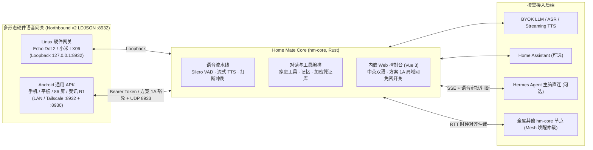

<div align="center">
  
  <h1>Home Mate (小瑞)</h1>
  <p>
    <strong>从零设计的全屋家庭伙伴 Agent 核心</strong> — 自适应全量/精简 Rust 大脑、多房间协同仲裁、零桥接主脑直连与中英双语控制台
  </p>
  <p>
    <em>A home companion agent built from scratch: adaptive full &amp; <code>--slim</code> Rust monolith core, multi-room mesh arbitration, direct Hermes Master Brain delegation, and bilingual Vue 3 console.</em>
  </p>

  <p>
    
    
    
    
  </p>

  <p>
    <a href="#生态三仓架构">生态三仓</a> ·
    <a href="#自适应构建与部署矩阵">部署矩阵</a> ·
    <a href="#使用前提条件">前提条件</a> ·
    <a href="#核心能力">核心能力</a> ·
    <a href="#快速启动与构建">快速启动</a> ·
    <a href="#许可协议">许可协议</a>
  </p>
</div>

---

## 生态三仓架构

**Home Mate** 采用 **核心大脑与硬件网关彻底解耦** 的模块化架构，由三大开源仓库组成：

| 仓库 | 定位 | 适用对象 |
|---|---|---|
| **`yes999zc/home-mate`**（本仓） | **核心大脑（`hm-core`）+ Vue 3 控制台 + 发布工具** | NAS / Docker / Linux 主机 / Echo Dot 2 / 小米 LX06 等单节点与全屋 Mesh |
| **[`yes999zc/home-mate-gateway-linux`](https://github.com/yes999zc/home-mate-gateway-linux)** | **Linux 多板卡硬件语音网关** | Echo Dot 2 (`board-dot2`)、小米小爱音箱 Pro LX06 (`board-lx06`) 等嵌入式音箱 |
| **[`yes999zc/home-mate-gateway-android`](https://github.com/yes999zc/home-mate-gateway-android)** | **Android 通用自适应 APK 客户端与语音网关** | 安卓手机、折叠屏、平板、带屏音箱、4 寸 86 墙面屏、斐讯 R1（Android 5–16） |



---

## 自适应构建与部署矩阵

同一份 `hm-core` 源码通过编译特征与运行参数自动适配不同算力与闪存约束的载体：

| 形态 | 构建方式 | 二进制 / 镜像特点 | 适用场景 |
|---|---|---|---|
| **NAS / Docker 容器版** | `docker compose up -d --build`（含全量特性） | 默认映射 TCP `:8930` 控制台与 `:8932` 语音网关（`HM_GATEWAY_ALLOW_LAN=1`）；若需 UDP `:8933` 广播发现可改用 `network_mode: host`（否则 Android 端仍可通过局域网网段扫描或手动 IP 接入） | 搭配 `home-mate-gateway-android`（手机/平板/86 屏/R1），一台 NAS 即可驱动全屋安卓终端 |
| **全量音箱版 (`full`)** | `./tools/build_core.sh`（默认启用 `silero-vad`） | 静态 `aarch64-unknown-linux-musl`（含内嵌 `tract-onnx` Silero VAD，约 19–25 MB） | Amazon Echo Dot 2 等具备充裕根分区/A/B 槽的独立音箱节点 |
| **精简音箱版 (`--slim`)** | `./tools/build_core.sh --slim`（`--no-default-features`） | 剔除 `tract-onnx`（约 13 MB，XZ 压缩后约 5 MB），依赖外部/侧车 VAD | 小米小爱 Pro (`LX06`, `/data` 仅 8 MB 可用) 等低闪存嵌入式设备 |

---

## 使用前提条件

1. **自带模型 API Key（BYOK）**：需在 Web 控制台「服务设置」中配置至少一组 OpenAI 兼容的 **LLM**（必需），以及用于语音交互的 **ASR** 与 **TTS** 服务（支持火山引擎、OpenAI 兼容接口或局域网自建语音服务）。所有密钥经 ChaCha20-Poly1305 本地加密存储在 `data/secret.key` 保护的 SQLite Vault 中。
2. **可选智能家居与主脑后端**：
   - **Home Assistant**：可选，配置 URL 与长期访问令牌后支持自然语言控灯/空调/场景并带写后回读校验。
   - **Hermes Agent 主脑直连**：可选，零桥接直连 Hermes HTTP/SSE API，支持将复杂长任务异步委派给电脑/服务器主脑，并通过音箱进行实时进度播报、语音审批确认与随时取消。
3. **局域网接入安全（方案 1A）**：
   - 默认 fail-closed：非本机回环请求要求管理员 Bearer Token。
   - 支持在 Web 控制台「安全设置」一键开启 **局域网可信设备免密豁免（`lan_gateway_exempt`）**：开启后仅对 RFC1918 私网与 Tailscale (`100.64.0.0/10`) 放行 `:8932` 语音网关及 `:8930` 日常对话/只读/媒体接口；高危管理接口（OTA、安全鉴权、凭证 Vault、备份导出/导入、出厂重置）**始终严格要求管理员 Token**。
   - 每个 `hm-core` 节点自动生成持久化非敏感指纹 `core_id`（`hmcore_<16hex>`）并通过 UDP `8933` 与 `/api/v0/auth` 广播，供客户端合并去重多网卡 / Tailscale 路由。

---

## 核心能力

| 领域 | 能力说明 |
|---|---|
| **低延迟全双工/半双工语音** | 唤醒词 + 退场/控播词本地反射、Silero VAD 端点检测、流式 TTS 边下边播与打断冲刷、防自听保护与多房间 RTT 时钟对齐唤醒仲裁 |
| **多网关并发与硬件隔离** | 同一 `hm-core` 支持本机回环音箱网关与多个局域网/Tailscale Android 端并发在线；强制防劫持隔离，本机音箱始终保持主输出与 OTA 健康校验优先权 |
| **家庭工具与长期记忆** | 天气、RSS/Atom 新闻、网络搜索、音乐（Subsonic/OpenAPI 曲库）、故事续播/笑话、定时提醒、Home Assistant 控家、共享家庭记忆与版本化 `USER.md` / `Agent.md` |
| **Hermes 主脑直连** | 内置 `brain.{delegate,status,steer,cancel}` 工具，SSE 实时监听 + 轮询降级，支持语音审批与即时取消 |
| **中英双语 Web 控制台** | Vue 3 + TypeScript，浅色/深色主题、简体中文/English 双语、4-Tab 分组设置、实时语音/网关诊断、全量加密配置导入导出 |
| **安全与 A/B 槽升级** | ChaCha20-Poly1305 静态凭证库、Ed25519 离线签名发布包、设备端验签、A/B 槽原子激活与健康检查自动回滚 |

---

## 快速启动与构建

### 1. NAS / Docker 一键启动（配合 Android 通用 APK）

```bash
# 克隆本仓库后构建并启动（默认映射 TCP :8930 控制台与 :8932 语音网关，数据持久化至 ./data；如需 UDP :8933 广播发现可使用 network_mode: host）
docker compose up -d --build
```

启动后访问 `http://<你的NAS或主机IP>:8930` 完成初始管理员配对与模型 Key 配置，并在 Android 客户端中点击「扫描局域网核心」即可连入。

### 2. 本地源码编译与全量测试（需要 Rust 1.100+ 与 Node.js 20+）

```bash
# 1. 代码行号门禁与体积门禁自测
python3 tools/line_gate.py
python3 tools/size_gate.py --self-test

# 2. Rust 格式、精简版编译校验、Clippy 与工作区全量测试
cargo fmt --all -- --check
cargo check -p hm-core --no-default-features --locked --all-targets
cargo clippy --workspace --locked --all-targets -- -W clippy::all
cargo test --workspace --locked

# 3. Web 控制台构建与全部回归测试
cd web && npm ci && npm run build
for t in tests/*.mjs; do node "$t"; done
```

### 3. 交叉编译嵌入式音箱二进制（`aarch64-unknown-linux-musl`）

```bash
# 全量版（含 in-process Silero VAD，供 Echo Dot 2 等设备使用）
./tools/build_core.sh

# 精简版（剔除 tract-onnx，供小米 LX06 等低闪存设备使用）
./tools/build_core.sh --slim
```

---

## 许可协议

Home Mate (小瑞) 采用 **开源双许可 + 协议例外** 策略：

- **开源使用 (`AGPL-3.0-only`)**：遵循 GNU Affero General Public License v3.0（见 [`LICENSE`](LICENSE)），面向个人、家庭自托管、学术研究与开源社区免费开放。
- **Northbound v2 协议例外 (`Apache-2.0`)**：设备网关北向协议规范与契约定义另行适用 Apache License 2.0（见 [`LICENSE-PROTOCOL-APACHE-2.0`](LICENSE-PROTOCOL-APACHE-2.0)），允许第三方硬件网关与 DIY 客户端自由对接而不受 AGPL 传染约束。
- **商业授权 / OEM 预装**：如需商业硬件预装、OEM 分发或闭源衍生，请联系版权方：`zhangcong1985@gmail.com` / `yes999zc@163.com`（官方网站：[https://mymate.homes](https://mymate.homes)）。
- 第三方依赖许可与模型致谢见 [`THIRD_PARTY_NOTICES.md`](THIRD_PARTY_NOTICES.md)。
