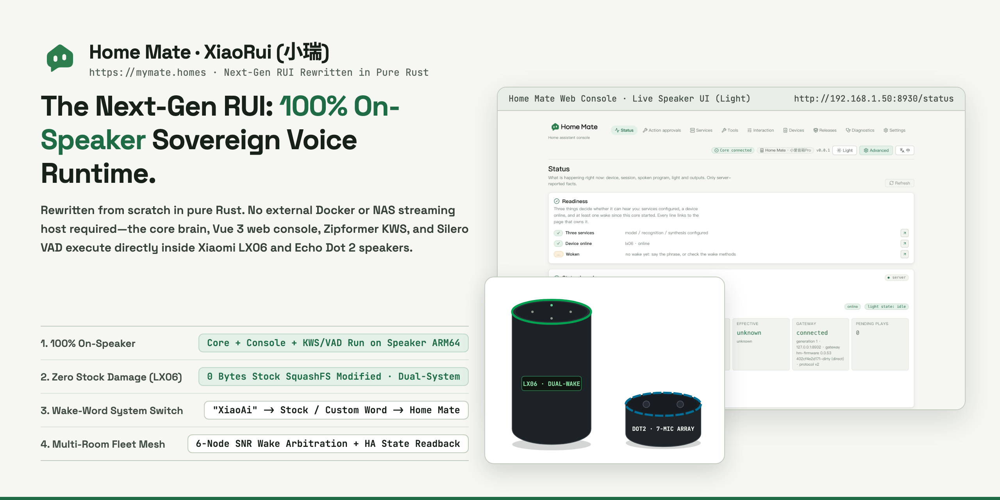
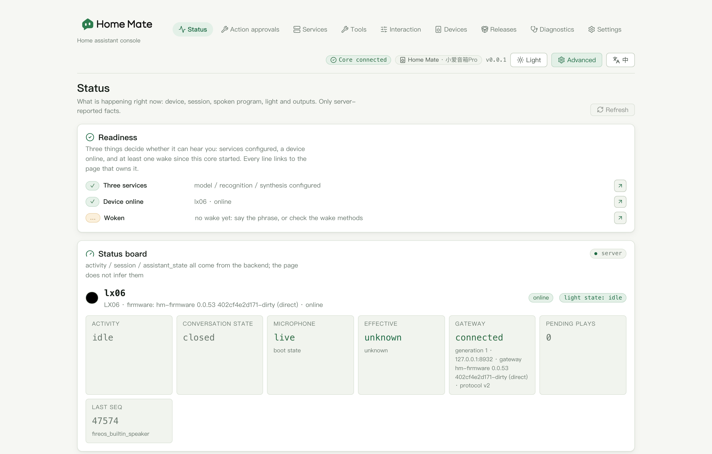
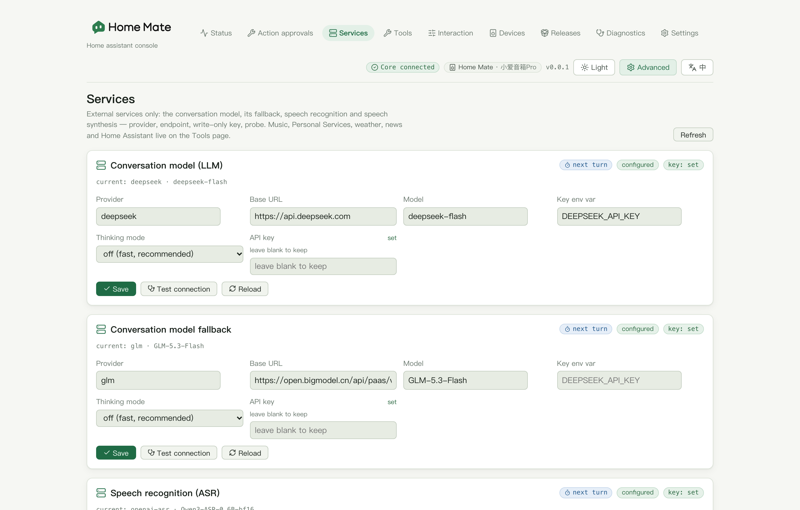
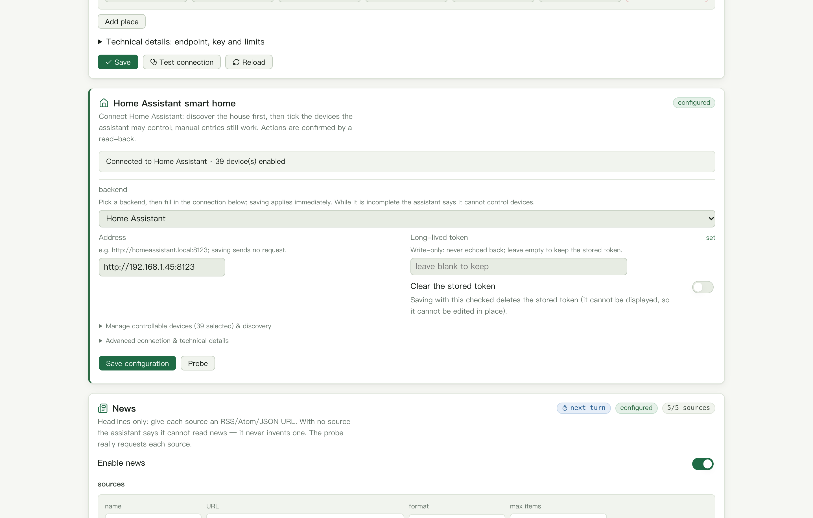

<p align="center">
  
</p>

<p align="center">
  <strong>English</strong> · <a href="README.zh-CN.md"><strong>简体中文</strong></a> · <a href="https://mymate.homes"><strong>Official Website (mymate.homes)</strong></a>
</p>

<p align="center">
  <a href="https://mymate.homes"></a>
  <a href="LICENSE"></a>
  <a href="LICENSE-PROTOCOL-APACHE-2.0"></a>
  
  
</p>

---

## What is Home Mate (XiaoRui / 小瑞)?

**Home Mate (小瑞)** is the next-generation evolution of [rui (小瑞)](https://github.com/yes999zc/rui). We rewrote the entire stack from scratch in **pure Rust** and fundamentally changed the architectural route:

Where first-generation `rui` required an always-on external server or NAS running Python/FastAPI in Docker while smart speakers acted as thin network microphones, **Home Mate moves the entire voice runtime 100% inside the speaker hardware itself**:
- **`hm-core`** — The voice agent brain, multi-room SNR wake arbiter, closed-loop Home Assistant controller, AEAD secret vault, and Vue 3 management plane (`:8930`).
- **`hm-gateway`** — Hardware-specific Rust daemon owning ALSA capture/playback, acoustic echo cancellation (AEC), LED ring animations, physical buttons, and speaker voicing EQ over Northbound Protocol v2 (`127.0.0.1:8932`).
- **`hm-kws`** — On-speaker C-ABI sidecar running a 3.3M int8 Zipformer keyword spotter and Silero VAD v4 neural endpoint detector with a 160ms pre-onset audio ring buffer.

> [!IMPORTANT]
> **Hardware Research Disclaimer & Custom Speaker Roadmap**
> 1. **For Research & Personal Experimentation Only**: Adaptation of third-party commercial speakers (**Xiaomi AI Speaker Pro `LX06`** and **Amazon Echo Dot 2 `RS03QR`**) in this project is provided **strictly for edge-AI architectural research, acoustic arbitration validation, and personal non-commercial experimentation**. All trademarks belong to their respective owners. This project is not affiliated with Xiaomi or Amazon and **does not sell modified third-party brand-name speakers**.
> 2. **First-Party Custom Speaker Under Active Development**: We are actively engineering a **dedicated custom Home Mate (小瑞) smart speaker hardware platform** featuring an open far-field microphone array, tuned acoustic enclosure, and native sovereign Rust firmware out of the box—requiring zero third-party unlock steps.

---

## Xiaomi AI Speaker Pro (`LX06`) Three Core Highlights

When deployed on the **Xiaomi AI Speaker Pro (`LX06`, Amlogic A113X `aarch64`)** via [yes999zc/home-mate-gateway-lx06](https://github.com/yes999zc/home-mate-gateway-lx06), Home Mate provides a non-invasive dual-system experience:

1. **100% On-Speaker Execution (No External Streaming Server)**
   - Through LTO optimization and `--no-default-features` (`--slim`) decoupling, `hm-core`, the Vue 3 Web Console, `hm-gateway` (`1.68 MiB`), and Silero `gateway_vad` pack into a **`4.84 MiB`** archive (`/data/hm/hm-bundle.tar.xz`).
   - On boot, `/data/hm/init.sh` unpacks the runtime into the speaker's **`120.9 MiB /tmp` RAM tmpfs**. Keyword spotting, neural VAD endpointing, the `:8930` Web Console, and multi-room SNR arbitration all execute on the speaker's own 4-core ARM64 CPU.
2. **Zero Damage to Stock Firmware (Dual-System Coexistence)**
   - **0 bytes modified in stock SquashFS**: Factory read-only `mtd4 (system0)` and `mtd5 (system1)` partitions remain **100% untouched** (zero brick risk).
   - Stock Xiaomi services (`mipns-xiaomi`, `mediaplayer`, Bluetooth, MiHome control) continue running normally alongside Home Mate.
   - **1-Line Factory Restore**: Run `rm -rf /data/hm /data/init.sh && reboot` over SSH to return to 100% factory stock state.
3. **Instant System Switching by Wake Word**
   - Both wake engines listen concurrently via ALSA `noop` (`dsnoop`) shared capture and release ALSA `softvol` playback immediately on idle:
     - Say **"XiaoAi TongXue" (小爱同学)** → Answered natively by stock Xiaomi XiaoAi.
     - Say **your custom wake word (e.g., "NiHao XiaoZhi")** → Answered by **Home Mate** (DeepSeek / GLM / OpenAI LLMs, local Qwen3-ASR, Volcengine `seed-tts-2.0`, and closed-loop Home Assistant readback).
     - Say **"QieHuan XiaoAi" (切换小爱)** during a session *(or double-tap the physical **CH** button on top of the speaker)* → Immediately hands off or pins exclusive stock XiaoAi control.

---

## Live Web Console Gallery (Light Theme Default · `:8930`)

Every speaker serves the responsive **Home Mate Web Console** directly from `http://<SPEAKER_IP>:8930` (defaulting to the high-contrast Light theme, with 1-click Dark theme and English/Chinese switching):

<table>
  <tr>
    <td width="50%">
      
      <p align="center"><strong>1. Status Overview (<code>/status</code>)</strong><br>Readiness checks, gateway connection generation, microphone capture state, and active program</p>
    </td>
    <td width="50%">
      
      <p align="center"><strong>2. Wake Words &amp; Follow-up (<code>/interaction</code>)</strong><br>Custom wake phrases, sensitivity thresholds, 9s follow-up window, and local exit words</p>
    </td>
  </tr>
  <tr>
    <td width="50%">
      
      <p align="center"><strong>3. Hardware &amp; Audio Gate (<code>/devices</code>)</strong><br>Speaker firmware status, room assignment, Silero VAD dBFS thresholds, and post-playback blind window</p>
    </td>
    <td width="50%">
      
      <p align="center"><strong>4. Speaker Voicing EQ (<code>/devices</code>)</strong><br>Dedicated 3-band custom woofer curve for Xiaomi LX06 and 10-band EchoMuse curve for Echo Dot 2</p>
    </td>
  </tr>
  <tr>
    <td width="50%">
      
      <p align="center"><strong>5. LLM, ASR &amp; TTS Services (<code>/services</code>)</strong><br>Primary/fallback LLMs (DeepSeek / GLM / OpenAI), Qwen3-ASR, and Volcengine seed-tts-2.0</p>
    </td>
    <td width="50%">
      
      <p align="center"><strong>6. Home Assistant Closed-Loop Readback (<code>/tools</code>)</strong><br>Auto-discovered Assist entities with mandatory post-action state readback verification</p>
    </td>
  </tr>
</table>

---

## On-Speaker Architecture & Repository Matrix

<p align="center">
  
</p>

| Repository | Target Role | License |
| :--- | :--- | :--- |
| **[yes999zc/home-mate](https://github.com/yes999zc/home-mate)** *(this repo)* | `hm-core` brain, `hm-release` Ed25519 signed OTA manager, Vue 3 Web Console (`web/`), `tools/hm-provision.sh`, and Northbound v2 protocol contract | `AGPL-3.0` (`Apache-2.0` for Protocol v2 spec) |
| **[yes999zc/home-mate-gateway-lx06](https://github.com/yes999zc/home-mate-gateway-lx06)** | Dedicated gateway for **Xiaomi AI Speaker Pro (`LX06`, Amlogic A113X `aarch64`)** — Storage Scheme A (`/data/hm` -> `/tmp/hm`), 100% on-speaker execution & Dual-System wake-word switching | `AGPL-3.0` |
| **[yes999zc/home-mate-gateway-dot2](https://github.com/yes999zc/home-mate-gateway-dot2)** | Dedicated gateway for **Amazon Echo Dot 2 (`RS03QR`, MT8163 7-mic array)** — 160ms hardware reference AEC lock, 12-LED 60fps RGB ring & emOS integration | `AGPL-3.0` |

---

## Device-Specific Prerequisites & Quickstart (Choose Your Speaker)

Xiaomi AI Speaker Pro (`LX06`) and Amazon Echo Dot 2 (`RS03QR`) are two completely separate hardware platforms. Follow the track for your specific speaker below.

### Track A: Xiaomi AI Speaker Pro (`LX06`) — Zero-Flash Dual-System Install

#### Prerequisites for LX06
1. **Hardware Model**: Black cylinder **Xiaomi AI Speaker Pro** (bottom label model **`LX06`**, Amlogic A113X `aarch64`).
2. **Root SSH Unlocked via `open-xiaoai`**: You must first enable root SSH access (port 22) using the community [idootop/open-xiaoai](https://github.com/idootop/open-xiaoai) project and verify `ssh root@<LX06_IP>` works.
3. **Free `/data` Space**: At least **5.5 MiB** free in `/data` (`df -k /data`).

#### Manual Commands for LX06
```bash
git clone https://github.com/yes999zc/home-mate.git "../home mate b"
git clone https://github.com/yes999zc/home-mate-gateway-lx06.git
cd home-mate-gateway-lx06
./tools/pack_lx06_bundle.sh

# Host the 8.5 MiB KWS model bundle on your LAN (fetched into /tmp/hm-kws on boot)
python3 -m http.server 18089 --directory build/lx06 &

# Deploy to /data/hm on your LX06 speaker (stock mtd4/mtd5 SquashFS untouched)
./deploy/lx06/install-lx06.sh --device-ip 192.168.1.50 --kws-url http://192.168.1.10:18089/hm-kws-lx06.tar.xz
```

#### Let an AI Coding Agent Deploy LX06 For You
Copy and paste this prompt into **Claude Code, Cursor, or Codex** *(remember to replace `192.168.1.50` and `192.168.1.10` with your own actual LAN IPs!)*:
```text
Please deploy Home Mate (XiaoRui) to my Xiaomi AI Speaker Pro (model LX06, root SSH already enabled via open-xiaoai):
[IMPORTANT: Replace the two example IPs below with your own actual LAN IPs]
- Speaker SSH: root@192.168.1.50        <-- Replace with your LX06 speaker's actual LAN IP
- LAN HTTP host IP: 192.168.1.10        <-- Replace with this computer's or your NAS's actual LAN IP

Steps to execute and verify (use my actual IPs above):
1. Clone https://github.com/yes999zc/home-mate.git and https://github.com/yes999zc/home-mate-gateway-lx06.git side by side.
2. SSH into root@<SPEAKER_IP> to verify `uname -m` is `aarch64` and `df -k /data` has >= 5500 KB available (clean old logs in /data/log/* if needed).
3. In home-mate-gateway-lx06, run `./tools/pack_lx06_bundle.sh` (or download prebuilt `hm-bundle.tar.xz` and `hm-kws-lx06.tar.xz` from GitHub Release v0.1.0), serve `build/lx06/` over HTTP on <HOST_IP>:18089, and verify `http://<HOST_IP>:18089/hm-kws-lx06.tar.xz` returns HTTP 200.
4. Run `./deploy/lx06/install-lx06.sh --device-ip <SPEAKER_IP> --kws-url http://<HOST_IP>:18089/hm-kws-lx06.tar.xz`.
5. Wait 15s for RAM unpack, call `POST http://<SPEAKER_IP>:8930/api/v0/auth/provision`, save the token to `~/.home-mate/lx06.token` (mode 0600), and print the console URL and token.
```

---

### Track B: Amazon Echo Dot 2 (`RS03QR`) — 1-Command Provisioning (`tools/hm-provision.sh`)

#### Prerequisites for Echo Dot 2
1. **Bootrom Unlocked via `firebreak` (`amonet`)**: Your 2nd-Generation Echo Dot (`RS03QR` "biscuit") must first be unlocked over Micro-USB using [yes999zc/firebreak](https://github.com/yes999zc/firebreak) (`uvx firebreak@latest`) with your stock `p10` partition backed up.
2. **`emOS` Audio Base Flashed & Connected to Wi-Fi**: The speaker must be running the `emOS` system layer (so the USB serial console `/dev/cu.usbmodem*` on macOS or `/dev/ttyACM*` on Linux reports `ID=emos`) and joined to your LAN via `em-wifi`.

#### Manual Commands for Echo Dot 2
Our bundled `tools/hm-provision.sh` (with built-in `tools/serial_cmd.py`) automates the entire Home Mate application layer—repairing `/data/emos/sockets`, installing the bootstrap seed, activating the Ed25519-signed release bundle, running `7/7` health checks, pairing the household token, and cloning household config from a reference speaker:

```bash
# 1. Run a read-only --dry-run first (verifies serial console, ID=emos, Wi-Fi IP & package hashes without writing):
./tools/hm-provision.sh --device-id dot2-living \
  --seed build/bootstrap/home-mate-bootstrap-dot2-living.tar.gz \
  --release build/release/home-mate-release-2026.11.22-98.tar \
  --serial /dev/cu.usbmodem8401 --ip 192.168.1.73 \
  --reference-node lx06 --reference-ip 192.168.1.50 \
  --wake-word 你好小智 --dry-run

# 2. Remove --dry-run to execute full installation, activation, token pairing & fleet config cloning:
./tools/hm-provision.sh --device-id dot2-living \
  --seed build/bootstrap/home-mate-bootstrap-dot2-living.tar.gz \
  --release build/release/home-mate-release-2026.11.22-98.tar \
  --serial /dev/cu.usbmodem8401 --ip 192.168.1.73 \
  --reference-node lx06 --reference-ip 192.168.1.50 \
  --wake-word 你好小智
```

#### Let an AI Coding Agent Provision Echo Dot 2 For You
Copy and paste this prompt into **Claude Code, Cursor, or Codex** *(remember to replace the example serial device and IPs with your own actual values!)*:
```text
I have an Amazon Echo Dot 2 (RS03QR) already unlocked via firebreak (amonet) and running the emOS audio base:
[IMPORTANT: Replace the example serial device and LAN IPs below with your own actual values]
- USB Serial Port: /dev/cu.usbmodem8401   <-- Replace with your actual USB serial device (or detect via `ls /dev/cu.usbmodem* /dev/ttyACM*`)
- Speaker LAN IP:  192.168.1.73           <-- Replace with your Echo Dot 2's actual Wi-Fi LAN IP
- (Optional) Reference Speaker IP: 192.168.1.50 <-- Replace with an existing configured speaker's IP if cloning household config

In the `home-mate` repository, please run `./tools/hm-provision.sh` to provision this speaker as `--device-id dot2-living` with `--wake-word 你好小智`:
1. Run `./tools/hm-provision.sh` with `--dry-run` first to verify serial reachability (`ID=emos`), `/data/emos/sockets`, and package hashes. Report the dry-run output before making changes.
2. Run `./tools/hm-provision.sh` without `--dry-run` (passing `--reference-node <REF_ID> --reference-ip <REF_ACTUAL_IP>` if a reference speaker exists) to install the seed, activate the signed release, verify 7/7 health checks, and save the token to `~/.home-mate/dot2-living.token`.
```

---

## Acknowledgments

Home Mate stands on the shoulders of many open-source projects and hardware communities. Full license details live in [THIRD_PARTY_NOTICES.md](THIRD_PARTY_NOTICES.md).

**Running in the on-speaker pipeline & unlock prerequisites**
- [idootop/open-xiaoai](https://github.com/idootop/open-xiaoai) & [@coderzc/open-xiaoai](https://github.com/coderzc/open-xiaoai) (MIT) — Community SSH unlock prerequisite and early voice client research for the Xiaomi AI Speaker Pro (`LX06`).
- [k2-fsa/sherpa-onnx](https://github.com/k2-fsa/sherpa-onnx) (Apache-2.0) & [Microsoft ONNX Runtime](https://github.com/microsoft/onnxruntime) (MIT) — C-ABI keyword spotting runtime and 3.3M int8 Zipformer model in `hm-kws`.
- [snakers4/silero-vad](https://github.com/snakers4/silero-vad) (MIT) — Silero VAD v4 neural voice activity detection model (`silero_vad.onnx`).
- [xiph/speexdsp](https://github.com/xiph/speexdsp) (BSD-3-Clause) — Acoustic echo cancellation (AEC) DSP primitives.
- [pdeljanov/Symphonia](https://github.com/pdeljanov/Symphonia) (MPL-2.0) — Pure-Rust streaming audio decoder (`mp3`, `flac`, `aac`, `isomp4`, `wav`, `pcm`).
- [Tokio](https://github.com/tokio-rs/tokio), [Axum](https://github.com/tokio-rs/axum), [Rusqlite](https://github.com/rusqlite/rusqlite), [RustCrypto](https://github.com/RustCrypto) (`chacha20poly1305`, `ed25519-dalek`), [Vue 3](https://github.com/vuejs/core), and [Lucide](https://github.com/lucide-icons/lucide).

**Architectural lineage & design inspirations**
- [yes999zc/rui (小瑞)](https://github.com/yes999zc/rui) — The predecessor of Home Mate. Home Mate inherits rui's household voice philosophy while rewriting the entire runtime in pure Rust to run 100% inside the speaker hardware.
- [wilbowes/EchoMuse](https://github.com/wilbowes/EchoMuse) — State machine, 2-inch driver voicing curve insights (`echomuse` EQ preset), and explainable-wizard console philosophy for Echo Dot 2 (no code copied).
- [Rhasspy](https://github.com/rhasspy/rhasspy) & [rhasspy/wyoming](https://github.com/rhasspy/wyoming) — Domain split and protocol layering between the core control plane and local audio gateway.
- [Home Assistant](https://github.com/home-assistant/core) & [Navidrome](https://github.com/navidrome/navidrome) / OpenSubsonic — Smart home entity exposure over WebSocket and self-hosted music library streaming.

---

## License & Contact

- **Open-Source License**: **[GNU AGPL v3.0](LICENSE)** for personal, family, and community self-hosting. The Northbound v2 protocol specification is licensed under **[Apache-2.0](LICENSE-PROTOCOL-APACHE-2.0)**.
- **Official Website**: **[https://mymate.homes](https://mymate.homes)**
- **Contact (Custom Speaker R&D / Commercial OEM Licensing)**: **`zhangcong1985@gmail.com`** / **`yes999zc@163.com`**
