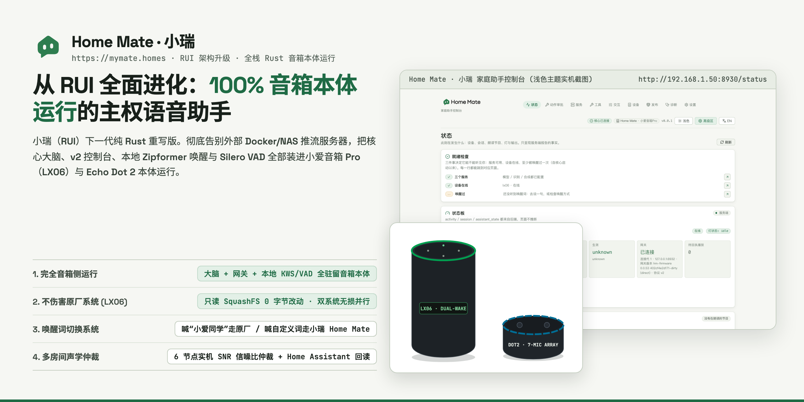
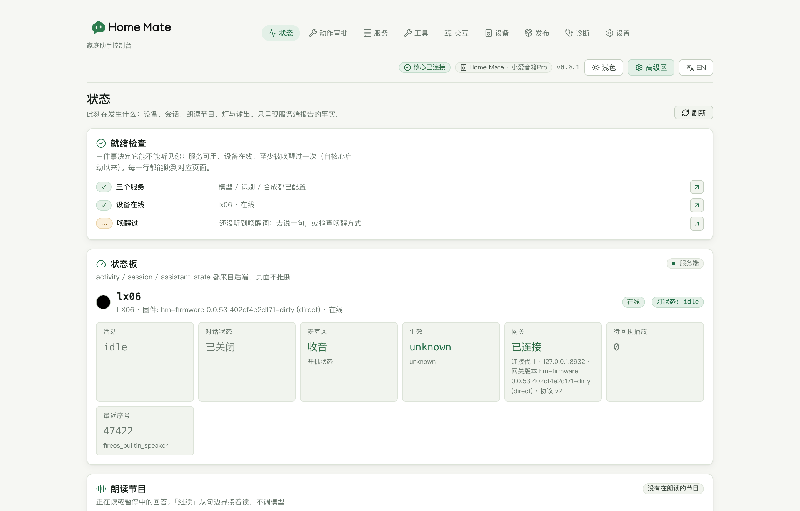
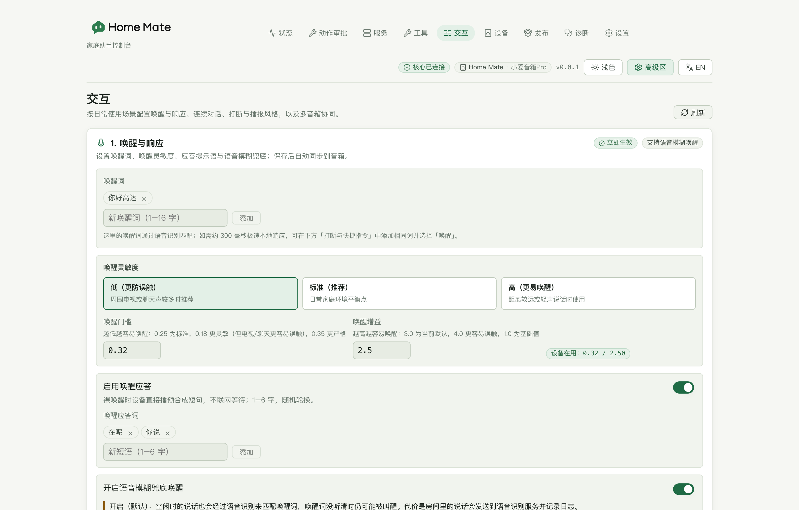
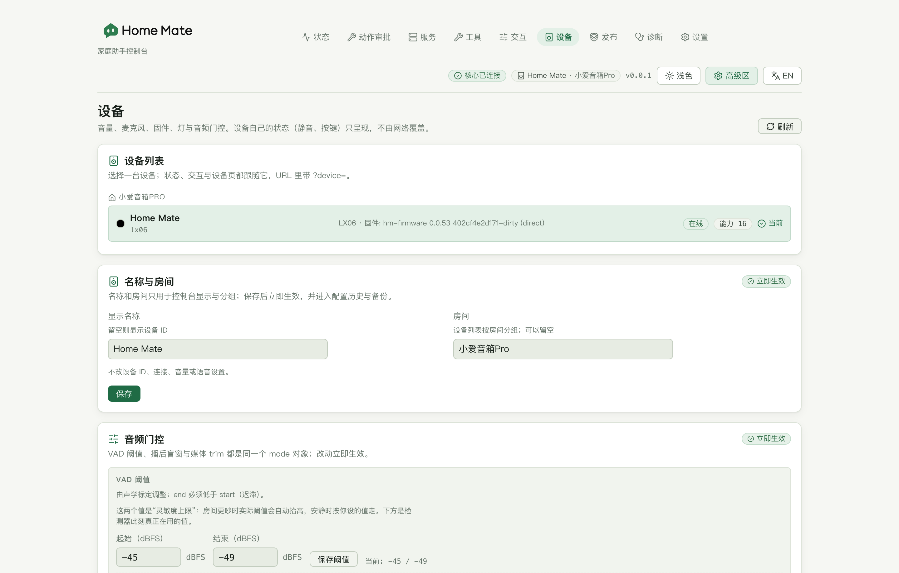
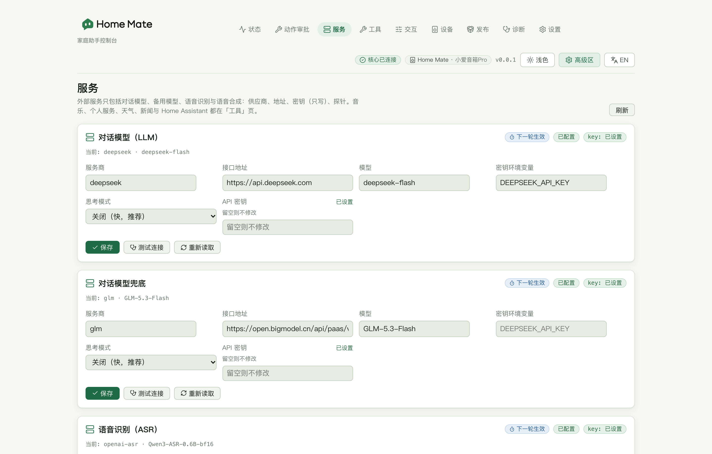
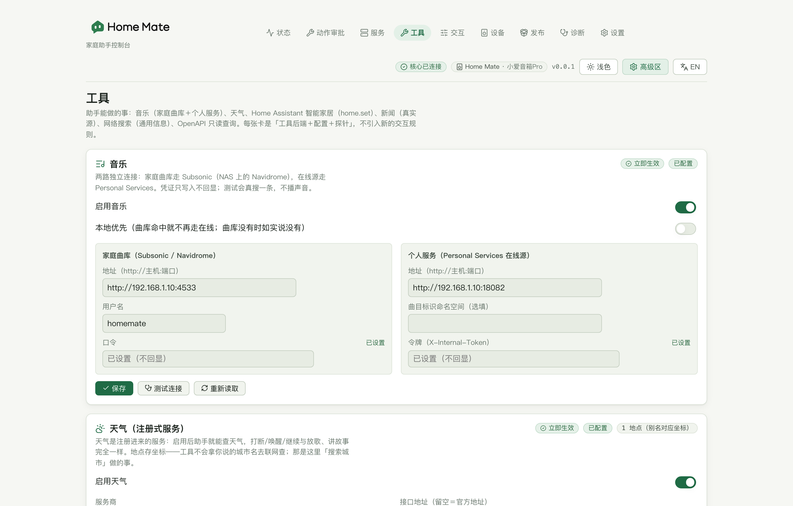
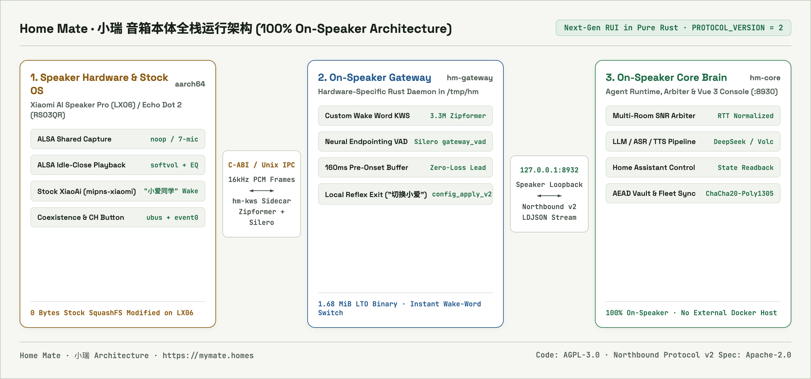

<p align="center">
  
</p>

<p align="center">
  <a href="README.md"><strong>English</strong></a> · <strong>简体中文</strong> · <a href="https://mymate.homes"><strong>官方网站 (mymate.homes)</strong></a>
</p>

<p align="center">
  <a href="https://mymate.homes"></a>
  <a href="LICENSE"></a>
  <a href="LICENSE-PROTOCOL-APACHE-2.0"></a>
  
  
</p>

---

## 这是什么？与第一代「小瑞 · rui」是什么关系？

**Home Mate（中文名：小瑞）** 是开源项目 [小瑞 · rui](https://github.com/yes999zc/rui) 的下一代全面架构升级版。我们**用纯 Rust 重写了全部代码，并彻底改变了技术路线**：

- 在第一代 `rui` 中，需要一台常开的外部服务器（NAS / 小主机）运行 Python FastAPI 与 Docker 容器，音箱只作为远程麦克风/喇叭卫星节点；
- 而在 **Home Mate · 小瑞** 中，核心大脑（`hm-core`）、Vue 3 网页管理控制台（`:8930`）、硬件音频网关（`hm-gateway`）以及离线热词与神经网络断句引擎（`hm-kws`：**3.3M Zipformer + Silero VAD v4**）**100% 直接运行在音箱自身的 ARM64 处理器与内存盘上**！不再需要外部 Docker 主机常驻推流，音箱插上电就是一台完整的主权 AI 语音终端。

> [!IMPORTANT]
> **硬件研究用途声明与自研定制音箱计划**
> 1. **存量音箱仅作技术研究使用**：本项目对**小米小爱音箱 Pro（`LX06`）**与**亚马逊 Echo Dot 2（`RS03QR`）**两款商业音箱的适配代码与部署脚本，**仅作为端侧纯 Rust 语音架构研究、多房间声学仲裁验证与个人非商业实验用途**。相关品牌与型号商标均归原厂商所有，本项目与小米、亚马逊无任何关联，**亦不售卖任何改装版第三方品牌音箱**。
> 2. **正在开发原生定制音箱**：我们正在自主研发**专为 Home Mate · 小瑞 打造的原生定制智能音箱硬件**（开放式远场多麦克风阵列、定制高保真声学腔体、出厂原生搭载主权 Rust 语音系统，无需任何第三方解锁前置步骤），敬请期待。

---

## 小米小爱音箱 Pro (`LX06`) 三大核心亮点

配合专属网关仓 [yes999zc/home-mate-gateway-lx06](https://github.com/yes999zc/home-mate-gateway-lx06)，小瑞在百元级神机**小米小爱音箱 Pro（黑色圆柱款 `LX06`，Amlogic A113X 四核 `aarch64`）**上实现了零风险双系统体验：

1. **完全音箱侧运行（告别外部 Docker 推流服务器）**
   - 通过 LTO 编译优化与 `--no-default-features`（`--slim`）拆解，`hm-core` 大脑、Vue 3 控制台、`hm-gateway`（仅 `1.68 MiB`）与 Silero `gateway_vad` 被压缩进 **`4.84 MiB`** 的主程序包（`/data/hm/hm-bundle.tar.xz`）。
   - 音箱开机时自动将主包解压至 **`120.9 MiB` 的 `/tmp` 内存盘**运行：热词唤醒、神经网络 VAD 断句、`:8930` 管理后台与多房间声学信噪比（SNR）仲裁全部在音箱本体闭环完成。
2. **不伤害本系统（双系统无损并行，零变砖风险）**
   - **原厂只读 SquashFS 分区 0 字节修改**：绝不触碰或重刷 `mtd4 (system0)` 与 `mtd5 (system1)` 原厂固件分区。
   - 原厂小爱服务栈（`mipns-xiaomi`、`mediaplayer`、米家蓝牙网关、原厂闹钟）保持原样运行。
   - 诊断与语音事件日志（`voice-events`）自动软链至 `/tmp` 内存盘并在 85% 水位自动轮转，绝不磨损或撑满 `13.3 MiB` 的 `/data` 闪存。
   - **一行命令无痕恢复出厂**：随时在 SSH 执行 `rm -rf /data/hm /data/init.sh && reboot`，重启后即 100% 回到纯原厂状态。
3. **唤醒词切换系统（喊谁谁应，无需拨开关）**
   - 两套系统的唤醒引擎通过 ALSA `noop`（`dsnoop`）共享 6 麦环形阵列同时监听，并在播放空闲时立即释放 `softvol` 句柄：
     - **喊“小爱同学”** → 直接由原厂小爱同学应答（米家设备控制、蓝牙网关、原厂技能照常使用）。
     - **喊“你好小智 / 你好高达”** *(可在后台任意自定义)* → 直接由**小瑞 Home Mate** 应答（调用 DeepSeek / GLM / OpenAI 大模型、本地 Qwen3-ASR、火山 `seed-tts-2.0` 与 Home Assistant 状态回读控制）。
     - **会话中说“切换小爱”** *(或双击音箱顶部的实体 **CH 键**)* → 立即本地退场交还声道，或一键锁定为纯原厂小爱独占模式。

---

## 实机管理后台界面（默认浅色主题 · `http://<音箱IP>:8930`）

每台音箱直接在本地 `8930` 端口提供响应式 Web 控制台（默认采用清爽高对比浅色主题，支持一键切换深色主题与中英双语）：

<table>
  <tr>
    <td width="50%">
      
      <p align="center"><strong>1. 状态总览 (<code>/status</code>)</strong><br>三大服务就绪检查、设备在线代次、麦克风收音状态与朗读节目进度</p>
    </td>
    <td width="50%">
      
      <p align="center"><strong>2. 唤醒与连续对话 (<code>/interaction</code>)</strong><br>自定义唤醒词、灵敏度阈值、9 秒免唤醒连续追问窗口与本地结束词（含“切换小爱”）</p>
    </td>
  </tr>
  <tr>
    <td width="50%">
      
      <p align="center"><strong>3. 硬件与音频门控 (<code>/devices</code>)</strong><br>LX06 固件状态、房间分组、Silero VAD 起止分贝门限与播后盲窗设置</p>
    </td>
    <td width="50%">
      
      <p align="center"><strong>4. 硬件声学均衡曲线 (<code>/devices</code>)</strong><br>LX06 专属 3 段低音防破音 EQ（120Hz/350Hz/3.2kHz）与 Dot2 专属 EchoMuse 曲线</p>
    </td>
  </tr>
  <tr>
    <td width="50%">
      
      <p align="center"><strong>5. 对话模型与语音服务 (<code>/services</code>)</strong><br>主备大模型（DeepSeek / GLM）、本地 Qwen3-ASR 语音识别与火山引擎 seed-tts-2.0</p>
    </td>
    <td width="50%">
      
      <p align="center"><strong>6. Home Assistant 状态回读闭环 (<code>/tools</code>)</strong><br>自动发现暴露实体，每次控制强制执行写后真实状态回读（没读回绝不谎报已完成）</p>
    </td>
  </tr>
</table>

---

## 音箱本体架构与三仓矩阵

<p align="center">
  
</p>

| 仓库 | 职责边界 | 开源许可证 |
| :--- | :--- | :--- |
| **[yes999zc/home-mate](https://github.com/yes999zc/home-mate)** *(本仓)* | `hm-core` 核心大脑、`hm-release` Ed25519 签名升级器、Vue 3 控制台（`web/`）、Dot2 一键配网脚本（`tools/hm-provision.sh`）与北向 v2 协议契约 | `AGPL-3.0`（北向 Protocol v2 规范为 `Apache-2.0`） |
| **[yes999zc/home-mate-gateway-lx06](https://github.com/yes999zc/home-mate-gateway-lx06)** | **小米小爱音箱 Pro（`LX06`，A113X `aarch64`）**专属硬件网关：方案 A 内存盘解压守护、100% 音箱侧运行、双系统共存与唤醒词切换 | `AGPL-3.0` |
| **[yes999zc/home-mate-gateway-dot2](https://github.com/yes999zc/home-mate-gateway-dot2)** | **亚马逊 Echo Dot 2（`RS03QR`，MT8163 7 麦阵列）**专属硬件网关：160ms 硬件参考锁回声消除、12 灯珠 60fps RGB 灯环与 emOS 集成 | `AGPL-3.0` |

---

## 分设备前置条件与安装向导（请按你手头的音箱型号选择）

小米小爱音箱 Pro（`LX06`）与亚马逊 Echo Dot 2（`RS03QR`）是两套硬件架构完全不同的设备，**请勿混用步骤**。

### 设备 A：小米小爱音箱 Pro (`LX06`) 免刷机双系统部署

#### LX06 必备前置条件
1. **确认硬件型号**：必须是黑色高圆柱款**小米小爱音箱 Pro（底部铭牌型号为 `LX06`，Amlogic A113X `aarch64`）**。
2. **自行完成 SSH 解锁**：请先参照开源社区项目 [idootop/open-xiaoai](https://github.com/idootop/open-xiaoai) 开启音箱的 root SSH 权限（端口 22），确认在电脑终端可执行 `ssh root@<音箱IP>` 登录。
3. **检查 `/data` 可用空间**：SSH 登录后执行 `df -k /data`，确认剩余可用空间 ≥ **`5.5 MiB`**。

#### LX06 手工安装三行命令
```bash
git clone https://github.com/yes999zc/home-mate.git "../home mate b"
git clone https://github.com/yes999zc/home-mate-gateway-lx06.git
cd home-mate-gateway-lx06
./tools/pack_lx06_bundle.sh

# 在局域网常开机器或本机通过 HTTP 托管 8.5 MiB 离线 KWS 模型包（音箱开机拉取到 /tmp/hm-kws）
python3 -m http.server 18089 --directory build/lx06 &

# 一键部署到小爱音箱 Pro /data/hm（绝不改动原厂只读 SquashFS 分区）
./deploy/lx06/install-lx06.sh --device-ip 192.168.1.50 --kws-url http://192.168.1.10:18089/hm-kws-lx06.tar.xz
```

#### 让 AI 编程助手（Claude Code / Cursor / Codex）代你一键部署 LX06
直接复制以下话术发给你的 AI 助手（**注意：复制后请把话术里的示例 IP `192.168.1.50` 和 `192.168.1.10` 替换为你自己的真实局域网 IP**）：
```text
请帮我将 Home Mate · 小瑞部署到我的小米小爱音箱 Pro（型号 LX06，已通过 open-xiaoai 开启 root SSH）：
【请先将下方两个示例 IP 替换为你自己的真实局域网 IP】
- 音箱 SSH 地址：root@192.168.1.50  <-- 替换为你小爱音箱 Pro 的实际局域网 IP（密码：open-xiaoai 或已配好免密）
- 局域网托管机 IP：192.168.1.10    <-- 替换为你当前电脑或常开 NAS 的实际局域网 IP

请按以下步骤依次执行并在每一步向我汇报事实结果（执行时请统一使用我上面提供的真实 IP）：
1. 克隆 https://github.com/yes999zc/home-mate.git 与 https://github.com/yes999zc/home-mate-gateway-lx06.git 到平级目录。
2. SSH 登录 root@<音箱IP> 检查 `uname -m`（确认为 aarch64）与 `df -k /data /tmp`（确认 /data 可用空间 >= 5500 KB；若不足请先帮我清理 /data/log/* 旧日志）。
3. 在 home-mate-gateway-lx06 目录执行 `./tools/pack_lx06_bundle.sh`（或直接从 GitHub Release v0.1.0 下载预编译好的 hm-bundle.tar.xz 与 hm-kws-lx06.tar.xz），并用后台 HTTP 服务在 <托管机IP>:18089 托管 build/lx06/ 目录（验证 curl -I http://<托管机IP>:18089/hm-kws-lx06.tar.xz 返回 200）。
4. 执行 `./deploy/lx06/install-lx06.sh --device-ip <音箱IP> --kws-url http://<托管机IP>:18089/hm-kws-lx06.tar.xz` 完成方案 A 免刷机安装（绝不修改 mtd4/mtd5 原厂只读分区）。
5. 等待 15 秒内存盘解压完成后，调用 `POST http://<音箱IP>:8930/api/v0/auth/provision` 生成家庭访问令牌并保存到本机 `~/.home-mate/lx06.token`（权限 0600），最后打印控制台地址与令牌供我登录。
```

---

### 设备 B：亚马逊 Echo Dot 2 (`RS03QR`) 一键配网脚本 (`tools/hm-provision.sh`)

#### Echo Dot 2 必备前置条件
1. **已通过 `firebreak / amonet` 解锁 Bootrom 并获得底层权限**：未解锁的原厂 Echo Dot 2（第二代，型号 `RS03QR`）需先使用 [yes999zc/firebreak](https://github.com/yes999zc/firebreak)（执行 `uvx firebreak@latest`）通过 Micro-USB 解锁 Bootrom（切勿先连 Alexa App 升级固件），并妥善保存原厂 `p10` 分区备份镜像。
2. **已刷入 `emOS` 音频系统底座并连上 Wi-Fi**：解锁后需已刷入 `emOS` 系统层，音箱通过 USB 数据线连上电脑后出现串口控制台（macOS 为 `/dev/cu.usbmodem*`，Linux 为 `/dev/ttyACM*`，串口 `/etc/os-release` 返回 `ID=emos`），且已在串口执行 `em-wifi` 连上家庭局域网。

#### Echo Dot 2 手工运行 `tools/hm-provision.sh`
一旦满足上述两个前置条件，本仓内置的 `tools/hm-provision.sh`（已随仓内置 `tools/serial_cmd.py` 串口通信工具）将一条命令全自动完成：**修复 `/data/emos/sockets` → 推送 `bootstrap` 种子包并重启交由 `emOS init` 守护 → 激活 Ed25519 签名 `home-mate-release` 包 → `7/7` 健康自检 → 签发家庭令牌 → 从家里已配好的主音箱一键克隆全套家庭配置并设置新唤醒词**：

```bash
# 1. 先加 --dry-run 执行只读预检（验证串口 ID=emos、Wi-Fi IP 与安装包哈希，不写入设备任何字节）：
./tools/hm-provision.sh --device-id dot2-living \
  --seed build/bootstrap/home-mate-bootstrap-dot2-living.tar.gz \
  --release build/release/home-mate-release-2026.11.22-98.tar \
  --serial /dev/cu.usbmodem8401 --ip 192.168.1.73 \
  --reference-node lx06 --reference-ip 192.168.1.50 \
  --wake-word 你好小智 --dry-run

# 2. 预检无误后，去掉 --dry-run 正式执行安装、激活、配对与全屋配置克隆：
./tools/hm-provision.sh --device-id dot2-living \
  --seed build/bootstrap/home-mate-bootstrap-dot2-living.tar.gz \
  --release build/release/home-mate-release-2026.11.22-98.tar \
  --serial /dev/cu.usbmodem8401 --ip 192.168.1.73 \
  --reference-node lx06 --reference-ip 192.168.1.50 \
  --wake-word 你好小智
```

#### 让 AI 编程助手代你完成 Echo Dot 2 刷机与克隆
直接复制以下话术发给 **Claude Code、Cursor 或 Codex**（**注意：复制后请把话术里的示例串口和示例 IP 替换为你自己的真实值**）：
```text
我有一台已经通过 firebreak (amonet) 解锁并刷好 emOS 音频底座的亚马逊 Echo Dot 2：
【请先将下方示例串口与示例 IP 替换为你自己的真实值】
- USB 串口设备：/dev/cu.usbmodem8401  <-- 替换为你电脑识别到的实际串口（或让 AI 执行 ls /dev/cu.usbmodem* /dev/ttyACM* 自动查找）
- 音箱局域网 IP：192.168.1.73         <-- 替换为你这台 Echo Dot 2 通过 em-wifi 连上后的实际局域网 IP
- （可选）家里已配好的参考音箱 IP：192.168.1.50 <-- 如需克隆已有节点配置，请替换为参考节点的实际 IP

请帮我在 `home-mate` 仓库下使用 `./tools/hm-provision.sh` 完成这台新节点（节点 ID 设为 `dot2-living`，唤醒词设为 `你好小智`）的应用层部署：
1. 先加上 `--dry-run` 参数运行一次 `./tools/hm-provision.sh`，向我展示串口 `ID=emos` 核验、`/data/emos/sockets` 状态、wlan0 IP 与将要执行的计划，确认 0 报错后再继续。
2. 去掉 `--dry-run` 正式执行 `./tools/hm-provision.sh`（若我上面提供了参考节点 IP，请加上 `--reference-node <参考节点ID> --reference-ip <参考节点真实IP>`），自动完成 bootstrap 种子包安装、重启交由 emOS init 守护、Ed25519 签名 release 包激活、7/7 健康自检与全屋配置克隆，并将生成的令牌保存到 `~/.home-mate/dot2-living.token`。
```

---

## 致谢

这个项目站在很多优秀开源作者与硬件社区的工作之上。按它们**在这套系统里的实际位置**分两类；完整许可证与分发声明见 [THIRD_PARTY_NOTICES.md](THIRD_PARTY_NOTICES.md)。

**跑在音箱链路或解锁前置里的**
- [idootop/open-xiaoai](https://github.com/idootop/open-xiaoai) 与 [@coderzc/open-xiaoai](https://github.com/coderzc/open-xiaoai)（MIT）—— 小米小爱音箱 Pro（`LX06`）的 SSH 开启前置方案与早期设备端协议探索基石。
- [k2-fsa/sherpa-onnx](https://github.com/k2-fsa/sherpa-onnx)（Apache-2.0）与 [Microsoft ONNX Runtime](https://github.com/microsoft/onnxruntime)（MIT）—— 音箱本地 `hm-kws` 进程的 C-ABI 语音推理运行时与 3.3M int8 Zipformer 自定义关键词检测模型。
- [snakers4/silero-vad](https://github.com/snakers4/silero-vad)（MIT）—— Silero VAD v4 神经网络语音端点检测模型（`silero_vad.onnx`）。
- [xiph/speexdsp](https://github.com/xiph/speexdsp)（BSD-3-Clause）—— 回声消除（AEC）DSP 原语。
- [pdeljanov/Symphonia](https://github.com/pdeljanov/Symphonia)（MPL-2.0）—— 纯 Rust 流式音频解码库（MP3 / FLAC / AAC / M4A / WAV / PCM）。
- [Tokio](https://github.com/tokio-rs/tokio)、[Axum](https://github.com/tokio-rs/axum)、[Rusqlite](https://github.com/rusqlite/rusqlite)、[RustCrypto](https://github.com/RustCrypto)（`chacha20poly1305`、`ed25519-dalek`）、[Vue 3](https://github.com/vuejs/core) 与 [Lucide](https://github.com/lucide-icons/lucide)。

**架构渊源与设计上参考的公开做法**
- [yes999zc/rui（小瑞）](https://github.com/yes999zc/rui) —— Home Mate 的第一代前身项目。Home Mate 延续了小瑞的家庭多房间语音心智，并用纯 Rust 将整套系统浓缩进音箱本体运行。
- [wilbowes/EchoMuse](https://github.com/wilbowes/EchoMuse) —— 设备管理控制台的状态机、「可解释向导」思路以及 Echo Dot 2 2 寸喇叭的声学补偿参考（未复制代码）。
- [Rhasspy](https://github.com/rhasspy/rhasspy) 的分域式职责拆分与 [rhasspy/wyoming](https://github.com/rhasspy/wyoming) 的音频协议层抽象。
- [Home Assistant](https://github.com/home-assistant/core) 的 Assist 暴露列表 WebSocket 机制，以及 [Navidrome](https://github.com/navidrome/navidrome) / OpenSubsonic 本地音乐库接口。

---

## 开源协议与联系方式

- **开源协议**：遵循 **[GNU AGPL v3.0](LICENSE)** 面向个人、极客与家庭免费开源；北向 v2 网关通信协议规范遵循 **[Apache-2.0](LICENSE-PROTOCOL-APACHE-2.0)**。
- **官方网站**：**[https://mymate.homes](https://mymate.homes)**
- **联系作者（自研定制音箱合作 / 商业 OEM 授权）**：**`zhangcong1985@gmail.com`** / **`yes999zc@163.com`**
